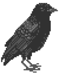
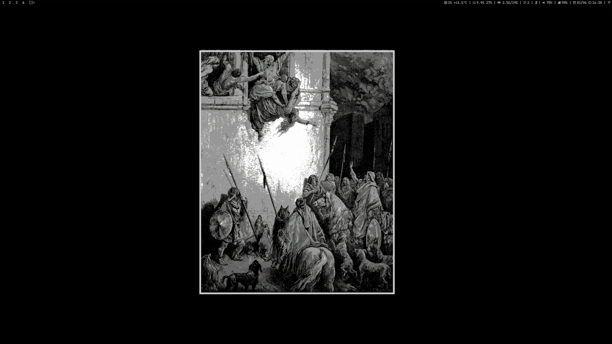
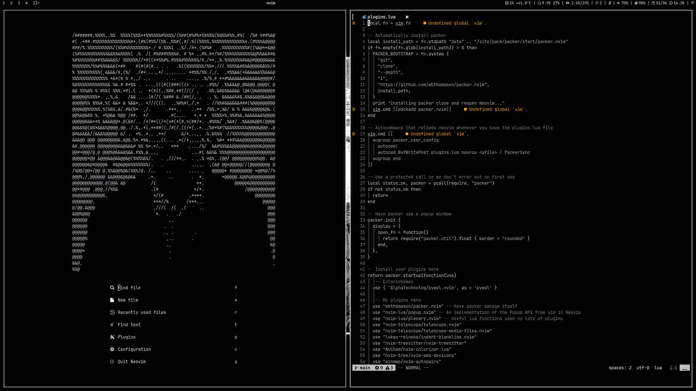
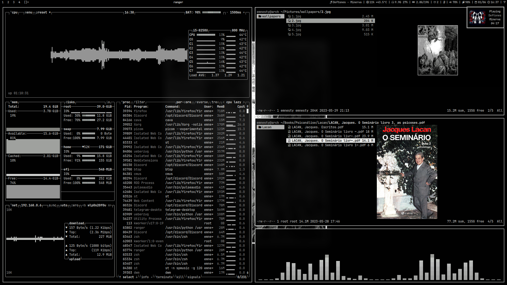
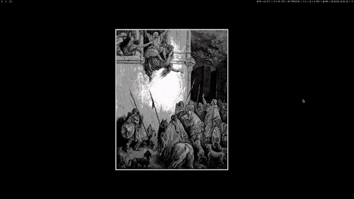

<div align="center">


## /home/emnesty/dotfiles


[](https://github.com/odrdk/dotfiles/stargazers)
[](https://github.com/odrdk/dotfiles/commits)
[](https://github.com/odrdk/dotfiles)







</div>

<div align="center">

```
Setup / DWM
```

</div>

```
Distro          -> Artix Linux
Editor          -> NeoVim
Browser         -> Firefox 
Shell           -> zsh
Process Viewer  -> btop

Music Player    -> cmus
Compositor      -> picom
Notifications   -> dunst
Media Player    -> mpv
File Manager    -> ranger

WM              -> dwm
Terminal        -> st
App Laucher     -> dmenu
Theme           -> pywal
Font            -> JetBrainsMono NF
```

<div align="center">

```
Installation
```

</div>

<details>
  <summary><b>Manual</b></summary>

<br>

> Assuming your <b>AUR Helper</b> is [yay](https://github.com/Jguer/yay). 
```
yay -S cava slop devour exa tty-clock-git picom-jonaburg-git cmatrix-git pipes.sh checkupdates+aur libnotify wal-telegram-git poppler npm p7zip epub-thumbailer-git python-pdftotext python-pywalfox tesseract-data-eng tesseract-data-por arandr clipmenu zsh playerctl dbus simple-mtpfs dunst feh ffmpeg ffmpegthumbnailer firefox flameshot fzf git gnu-free-fonts go htop imagemagick mpv neofetch neovim noto-fonts noto-fonts-cjk noto-fonts-emoji numlockx obs-studio openssh perl pulseaudio pulsemixer python-pip python-pywal ranger syncthing sxiv telegram-desktop tmux tree ttf-jetbrains-mono-nerd ttf-font-awesome gpick ueberzug redshift unzip vim webkit2gtk xclip yt-dlp zathura zathura-djvu zathura-pdf-mupdf zip xorg-server xorg-xinit libx11 libxinerama libxft base base-devel
```

```
git clone https://github.com/odrdk/dotfiles.git
```
> Create [symbolic links](https://www.freecodecamp.org/news/linux-ln-how-to-create-a-symbolic-link-in-linux-example-bash-command/) to the files/directories you need.
</details>

<details>
  <summary><b>Automatic</b></summary>

<br>

> Install [git](https://github.com/git/git)

```
sudo pacman -Syu git
```

> Clone this repo 

```
git clone https://github.com/odrdk/dotfiles.git
```

> Go to folder

```
cd dotfiles/
```

> Give permission to the script

```
chmod +x install.sh
```

> Execute the script

```
./install.sh
```

</details>

<div align="center">

```
Suckless Build
```

</div>

<details>
<summary><b>DWM Patches 火</b></summary>
<br>  
<table>
  <tr>
    <td>
      <a href="https://dwm.suckless.org/patches/xresources/">
        <p title="Allows to handle settings from Xresources."><kbd>xresources</kbd></p>
      </a>
    </td>
    <td>
      <a href="https://dwm.suckless.org/patches/vanitygaps/">
        <p title="Adds gaps between client windows.
        Add cfacts patch.
        Adds layouts: spiral, dwindle, bstack, bstackhoriz
        nrowgrid, horizgrid, gaplessgrid, centeredmaster
            centeredfloatingmaster, grid, deck"><kbd>vanitygapscombo</kbd></p>
      </a>
    </td>
    <td>
      <a href="https://dwm.suckless.org/patches/alpha/">
        <p title="Allow dwm to have translucent bars, while keeping all the text on it opaque."><kbd>alpha</kbd></p>
      </a>
    </td>
    <td>
      <a href="https://dwm.suckless.org/patches/preserveonrestart/">
        <p title="Preserves clients on old tags."><kbd>preserveonrestart</kbd></p>
      </a>
    </td>
    <td>
      <a href="https://dwm.suckless.org/patches/movestack/">
        <p title="Allows you to move clients around in the stack and swap them with the master."><kbd>movestack</kbd></p>
      </a>
    </td>
    <td>
      <a href="https://dwm.suckless.org/patches/bar_height/">
        <p title="This patch allows user to change dwm's default bar height."><kbd>barheight</kbd></p>
      </a>
    </td>
    <td>
      <a href="https://dwm.suckless.org/patches/togglefloatingcenter/">
        <p title="This patch will allows you to toggle floating window client will be centered position."><kbd>togglefloatingcenter</kbd></p>
      </a>
    </td>
  </tr>
  <tr>
    <td>
      <a href="https://dwm.suckless.org/patches/statuscmd/">
        <p title="This patch adds the ability to signal a status monitor."><kbd>statuscmd</kbd></p>
      </a>
    </td>
    <td>
      <a href="https://dwm.suckless.org/patches/statusallmons/">
        <p title="Draws and updates the statusbar on all monitors."><kbd>statusallmons</kbd></p>
      </a>
    </td>
    <td>
      <a href="https://dwm.suckless.org/patches/swallow/">
        <p title='Adds "window swallowing" to dwm.'><kbd>swallow</kbd></p>
      </a>
    </td>
    <td>
      <a href="https://dwm.suckless.org/patches/alttagsdecoration/">
        <p title="Provides the ability to use an alternative text for tags which contain at least one window."><kbd>alttagsdecoration</kbd></p>
      </a>
    </td>
     <td>
      <a href="https://dwm.suckless.org/patches/save_floats/">
        <p title="This patch saves size and position of every floating window before it is forced into tiled mode."><kbd>savefloats</kbd></p>
      </a>
    </td>
    <td>
      <a href="https://dwm.suckless.org/patches/resizecorners/">
        <p title="The mouse is warped to the nearest corner and you resize it from there."><kbd>resizecorners</kbd></p>
      </a>
    </td>
    <td>
      <a href="https://dwm.suckless.org/patches/focusonnetactive/">
        <p title="Patch to activate window instead of urgency."><kbd>focusonnetactive</kbd></p>
      </a>
    </td>
  </tr>
  <tr>
    <td>
      <a href="https://dwm.suckless.org/patches/winicon/">
        <p title="A patch that enables dwm to show window icons."><kbd>winicon</kbd></p>
      </a>
    </td>
    <td>
      <a href="https://dwm.suckless.org/patches/awesomebar/">
        <p title="This patch changes the taskbar to be more like awesome."><kbd>awesomebar</kbd></p>
      </a>
    </td>
    <td>
      <a href="https://dwm.suckless.org/patches/noborder/">
        <p title="Remove the border when there is only one window visible."><kbd>noborder</kbd></p>
      </a>
    </td>
    <td>
      <a href="https://dwm.suckless.org/patches/centeredwindowname/">
        <p title="Center the WM_NAME of the currently selected window on the status bar."> <kbd>centeredwindowname</kbd></p>
      </a>
    </td>
    <td>
      <a href="https://dwm.suckless.org/patches/exitmenu/">
        <p title="Simple exit menu for dwm."><kbd>exitmenu</kbd></p>
      </a>
    </td>
    <td>
      <a href="https://dwm.suckless.org/patches/windowmap/">
        <p title="This patch makes the windows get mapped or unmapped in Xorg. Fixing black screen when switch back to a fullscreen service."><kbd>windowmap</kbd></p>
      </a>
    </td>
    <td>
      <a href="https://dwm.suckless.org/patches/underlinetags/">
        <p title="Underlines selected tags."><kbd>underlinetags</kbd></p>
      </a>
    </td>
  </tr>
  <tr>
    <td>
      <a href="https://dwm.suckless.org/patches/statusbutton/">
        <p title="Adds a clickable button to the left hand side of the statusbar."><kbd>statusbutton</kbd></p>
      </a>
    </td>
    <td>
      <a href="https://dwm.suckless.org/patches/scratchpads/">
        <p title="Enables multiple scratchpads."><kbd>scratchpads</kbd></p>
      </a>
    </td>
     <td>
      <a href="https://dwm.suckless.org/patches/pertag/">
        <p title="Keeps layout, mwfact, barpos and nmaster per tag."><kbd>pertag</kbd></p>
      </a>
    </td>
    <td>
      <a href="https://dwm.suckless.org/patches/attachdirection/">
        <p title="Attachdirection is a merge of:
        attachabove
        attachaside
        attachbelow
        attachbottom
        attachtop."><kbd>attachdirection</kbd></p>
      </a>
    </td>
        <td>
      <a href="https://github.com/bakkeby/patches/blob/master/dwm/dwm-placemouse-6.2.diff">
        <p title="This patch allows you to move windows with the mouse without switching to floating mode."><kbd>placemouse</kbd></p>
      </a>
    </td>
    <td>
      <a href="https://dwm.suckless.org/patches/moveresize/">
        <p title="This patch allows you to move and resize dwm's clients using keyboard bindings."><kbd>moveresize</kbd></p>
      </a>
    </td>
    <td>
      <a href="https://dwm.suckless.org/patches/dynamicscratchpads/">
        <p title="This patch allows for the management of scratchpad windows dynamically."><kbd>dynamicscratchpads</kbd></p>
      </a>
    </td>
  </tr>
  <tr>
    <td>
      <a href="https://dwm.suckless.org/patches/floatrules/">
        <p title="Adds 5 extra variables to the 'rules' array in config.def.h."><kbd>floatrules</kbd></p>
      </a>
    </td>
    <td>
      <a href="https://dwm.suckless.org/patches/barpadding/">
        <p title="Adds variables for verticle and horizontal space between the statusbar."><kbd>barpadding</kbd></p>
      </a>
    </td>
    <td>
      <a href="https://dwm.suckless.org/patches/sticky/">
        <p title="A sticky client is visible on all tags."><kbd>sticky</kbd></p>
      </a>
    </td>
    <td>
      <a href="https://dwm.suckless.org/patches/stickyindicator/">
        <p title="Adds indicator in their bar to show when a window is sticky."><kbd>stickyindicator</kbd></p>
      </a>
    </td>
    <td>
      <a href="https://github.com/bakkeby/patches/blob/master/dwm/dwm-dragfact-6.3.diff">
        <p title="Allows resizing of windows with the mouse."><kbd>dragfact</kbd></p>
      </a>
    </td>
    <td>
      <a href="https://dwm.suckless.org/patches/tag-previews/">
        <p title="Allows you to see the contents of an already viewed tag."><kbd>tagpreview</kbd></p>
      </a>
    </td>
    <td>
      <a href="https://dwm.suckless.org/patches/hide_vacant_tags/">
        <p title="This patch prevents dwm from drawing tags with no clients on the bar."><kbd>hidevacanttags</kbd></p>
      </a>
    </td>
  </tr>
  <tr>
    <td>
      <a href="https://github.com/bakkeby/patches/blob/master/dwm/dwm-riodraw-nopidmatching-6.3_full.diff">
        <p title="Adding rio-like draw-to-resize windows."><kbd>riodraw</kbd></p>
      </a>
    </td>
    <td>
      <a href="https://dwm.suckless.org/patches/layoutmenu/">
        <p title="Adds a context menu for layout switching."><kbd>layoutmenu</kbd></p>
      </a>
    </td>
    <td>
      <a href="https://dwm.suckless.org/patches/center/">
        <p title="Add an iscentered rule to automatically center clients."><kbd>center</kbd></p>
      </a>
    </td>
     <td>
      <a href="https://dwm.suckless.org/patches/systray/">
        <p title="A simple system tray implementation."><kbd>systray</kbd></p>
      </a>
    </td>

  </tr>
</table>
  
  **Note**
 
  Hover over the patch to receive information about it.
  
</details>
<details>
<summary><b>ST Patches 水</b></summary>
<br>  
<table>
    <td>
      <a href="https://st.suckless.org/patches/xresources/">
        <p title="Adds the ability to configure st via Xresources."><kbd>xresources</kbd></p>
      </a>
    </td>
    <td>
      <a href="https://st.suckless.org/patches/font2/">
        <p title="Allows to add spare font besides default."><kbd>font2</kbd></p>
      </a>
    </td>
    <td>
      <a href="https://st.suckless.org/patches/desktopentry/">
        <p title="Creates a desktop-entry for st."><kbd>desktopentry</kbd></p>
      </a>
    </td>
    <td>
      <a href="https://st.suckless.org/patches/scrollback/">
        <p title="Scroll back through terminal output."><kbd>scrollback</kbd></p>
      </a>
    </td>
    </td>
    <td>
      <a href="https://st.suckless.org/patches/scrollback/st-scrollback-mouse-20220127-2c5edf2.diff">
        <p title="Apply the following patch on top of the previous to allow scrolling using mouse."><kbd>scrollback-mouse</kbd></p>
      </a>
    </td>
    <td>
      <a href="https://st.suckless.org/patches/boxdraw/">
        <p title="Custom rendering of lines/blocks/braille characters for gapless alignment."><kbd>boxdraw</kbd></p>
      </a>
    </td>
  </tr>
  <tr>
    <td>
      <a href="https://st.suckless.org/patches/netwmicon">
        <p title="Enables to set _NET_WM_ICON with a png-image."><kbd>netwmicon</kbd></p>
      </a>
    </td>
    <td>
      <a href="https://st.suckless.org/patches/alpha/">
        <p title="Allows users to change the opacity of the background."><kbd>alpha</kbd></p>
      </a>
    </td>
    <td>
      <a href="https://github.com/odrdk/dotfiles/blob/main/.config/suckless/st/patches/patch_column.diff">
        <p title="Invisible content is kept instead of removed when shrinking the width of the st window."><kbd>patch_column</kbd></p>
      </a>
    </td>
    <td>
      <a href="https://st.suckless.org/patches/workingdir">
        <p title="Allows user to specify the initial path st should use as working directory."><kbd>workingdir</kbd></p>
      </a>
    </td>
    <td>
      <a href="https://st.suckless.org/patches/glyph_wide_support/">
        <p title="This patch fixes wide glyphs truncation."><kbd>glyph-wide-support</kbd></p>
      </a>
    </td>
    <td>
      <a href="https://st.suckless.org/patches/drag-n-drop/">
        <p title="This patch adds XDND Drag-and-Drop support for st."><kbd>drag n drop</kbd></p>
      </a>
    </td>
  </tr>
  <tr>
    <td>
      <a href="https://st.suckless.org/patches/blinking_cursor/">
        <p title="This patch allows the use of a blinking cursor."><kbd>blinking cursor</kbd></p>
      </a>
    </td>
  </tr>
</table>

  **Note**
 
  Hover over the patch to receive information about it.
</details>

<details>
<summary><b>DMENU Patches 矢</b></summary>
<br>
<table>
  <tr>
    <td>
      <a href="https://tools.suckless.org/dmenu/patches/listfullwidth/">
        <p title="This patch fixes the prompt width."><kbd>listfullwidth</kbd></p>
      </a>
    </td>
    <td>
      <a href="https://tools.suckless.org/dmenu/patches/xresources/">
        <p title="Adds the ability to configure dmenu via Xresources."><kbd>xresources</kbd></p>
      </a>
    </td>
    <td>
      <a href="https://tools.suckless.org/dmenu/patches/border/">
        <p title="Adds a border around the dmenu window."><kbd>border</kbd></p>
      </a>
    </td>
    <td>
      <a href="https://tools.suckless.org/dmenu/patches/password/">
        <p title="Will not directly display the keyboard input."><kbd>password</kbd></p>
      </a>
    </td>
      <td>
      <a href="https://tools.suckless.org/dmenu/patches/alpha/">
        <p title="Adds translucency to the dmenu window, while keeping the text in it opaque."><kbd>alpha</kbd></p>
      </a>
    </td>
    <td>
      <a href="https://tools.suckless.org/dmenu/patches/numbers/">
        <p title="Adds text which displays the number of matched and total items in the top right corner of dmenu."><kbd>numbers</kbd></p>
      </a>
    </td>
    <td>
      <a href="https://tools.suckless.org/dmenu/patches/center/">
        <p title="Centers dmenu in the middle of the screen."><kbd>center</kbd></p>
      </a>
    </td>
  </tr>
  <tr>
    <td>
      <a href="https://tools.suckless.org/dmenu/patches/case-insensitive/">
        <p title="Changes case-insensitive item matching to default behaviour."><kbd>case-insensitive</kbd></p>
      </a>
   </td>
    <td>
      <a href="https://tools.suckless.org/dmenu/patches/fuzzymatch/">
        <p title="Adds support for fuzzy-matching to dmenu."><kbd>fuzzymatch</kbd></p>
      </a>
   </td>
    <td>
      <a href="https://tools.suckless.org/dmenu/patches/fuzzyhighlight/">
        <p title="Fuzzy matches gets highlighted."><kbd>fuzzyhighlight</kbd></p>
      </a>
   </td>
</tr>
</table>

  **Note**
 
  Hover over the patch to receive information about it.
</details>

<details>
  <summary><b>Keybinds</b></summary>

<br>

- `Super` + `Enter` = <i>Create a new terminal.</i>
- `Super` + `Shift` + `Q` = <i>Close a window.</i>
- `Super` + `Shift` + `R` = <i>Restart DWM.</i>
- `Super` + `LeftArrow`, `RightArrow` = <i>Move to another window.</i>
- `Super` + `M` = <i>Monocle layout.</i>
- `Super` + `T` = <i>Tiled layout.</i>
- `Super` + `F` = <i>Spiral layout.</i>
- `Super` + `U` = <i>Centered master layout.</i>
- `Super` + `O` = <i>Grid layout.</i>
- `Super` + `B` = <i>Toggle the top bar.</i>
- `Super` + `Shift` + 1/5 = <i>Move a window to another tag.</i>
- `Super` + `1/5` = <i>Switch to another tag.</i>
- `Super` + `I` = <i>Increment master.</i>
- `Super` + `D` = <i>Decrement master.</i>
- `Super` + `H` = <i>Move mfact to the left.</i>
- `Super` + `L` = <i>Move mfact to the right.</i>
- `Super` + `K` = <i>Move cfact down.</i>
- `Super` + `J` = <i>Move cfact up.</i>
- `Super` + `Space` = <i>Toggle last layout.</i>
- `Super` + `Shift` + Space = <i>Toggle floating window.</i>
- `Super` + ``=`` = <i>Increment gaps.</i>
- `Super` + ``-`` = <i>Decrement gaps.</i>
- `Super` + `Alt` + 0 = <i>Restore gaps.</i>
- `Super` + `Shift` + = = <i>Increment vertical gaps.</i>
- `Super` + `Shift` + - = <i>Decrement vertical gaps.</i>
- `Super` + `Control` + = = <i>Increment horizontal gaps.</i>
- `Super` + `Control` + - = <i>Decrement horizontal gaps.</i>
- `Super` + `Alt` + ``=`` = <i>Increment inside gaps.</i>
- `Super` + `Alt` + ``-`` = <i>Decrement inside gaps.</i>
- `Super` + `F1` = <i>Open file manager.</i>
- `Super` + `F2` = <i>Open browser.</i>
- `Super` + `F3` = <i>Open messaging application.</i>
- `Super` + `F4` = <i>Open music player.</i>
- `Super` + `F5` = <i>Open code editor.</i>
- `Super` + `F6` = <i>Open audio manager.</i>
- `Super` + `F7` = <i>Open screen recorder.</i>
- `Super` + `F11` = <i>Lockscreen.</i>
- `Super` + `F12` = <i>Open calculator.</i>
- `Super` + `Shift` + N = <i>Toggle nightmode.</i>
- `Super` + `Shift` + E = <i>Theme selector.</i>
- `Super` + `Control` + E = <i>Emoji selector.</i>
- `Super` + `Shift` + S = <i>Manage dotfiles.</i>
- `Super` + `Shift` + Y = <i>Manage clipboard.</i>
- `Super` + `PrtSc` = <i>Fullscreen screenshot.</i>
- `PrtSc` = <i>Screenshot of the selected area.</i>
- `AudioLowerVolume` = <i>Volume control down.</i>
- `AudioRaiseVolume` = <i>Volume control up.</i>
- `AudioMute` = <i>Toggle mute.</i>
- `Alt` + `Z` = <i>Toggle mute mic.</i>
- `MonBrightnessUp` = <i>Increment brightness.</i>
- `MonBrightnessDown` = <i>Decrement brightness.</i>
- `Super` + `Shift` + `P` = <i>Power Menu.</i>
- `Super` + `P` = <i>Open DMENU.</i>

</details>

